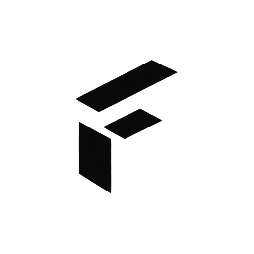

  

# Forma Solutions

We build reusable software components and tools.

## Forma

Our first project is **Forma**, a React design-system library for consistent interfaces across applications.

- React components built on Base UI and shadcn/ui.
- Tailwind CSS themes with light and dark modes.
- TypeScript types, component documentation, and behavior tests.

**Status:** In development. The npm package is not yet published.

## Contact

[contact@formasolutions.dev](mailto:contact@formasolutions.dev)
